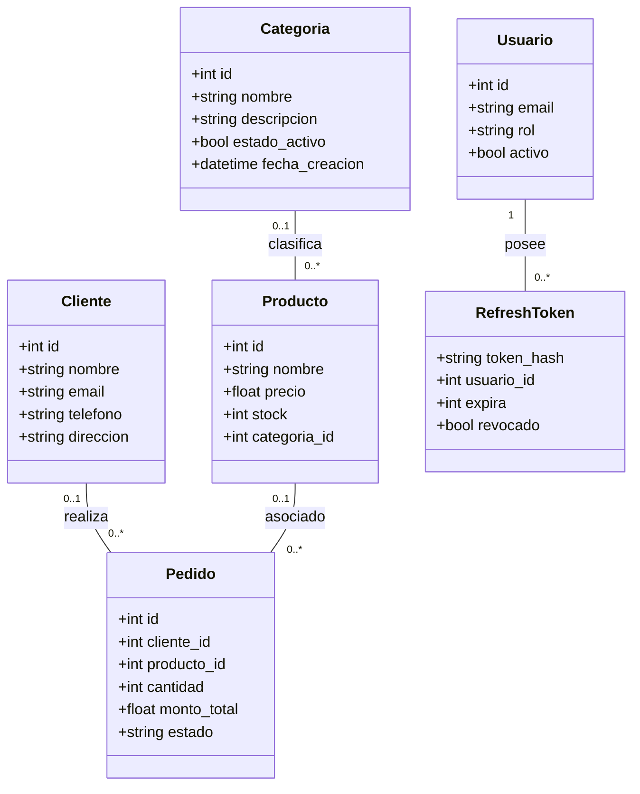

# Diagrama de clases de la Cafetería Universitaria

`Cliente` identifica a un comprador y `Usuario` a una cuenta de acceso independiente. Las claves foráneas de negocio admiten valores nulos en PostgreSQL. Los DTO de creación exigen identificadores válidos. Las clases de autenticación muestran sus atributos principales. El [diagrama de datos](diagrama-datos.md) incluye todas las columnas.
