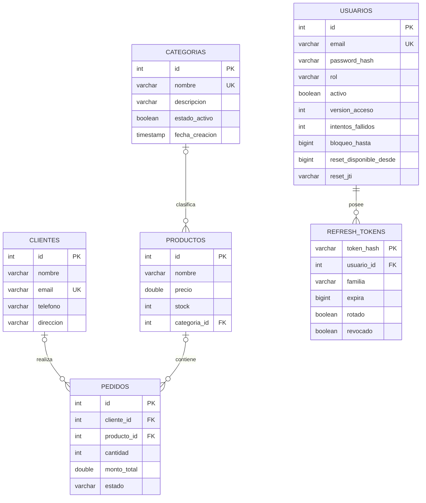

# Diagrama de datos de la Cafetería Universitaria

PK identifica la clave primaria, FK la clave foránea y UK una columna única. Las claves foráneas de negocio admiten valores nulos. Cada refresh requiere un usuario y se elimina en cascada al eliminar la cuenta. El correo de acceso es único en `usuarios` y el rol admite `usuario` o `admin`. `usuarios` y `clientes` almacenan registros independientes.
