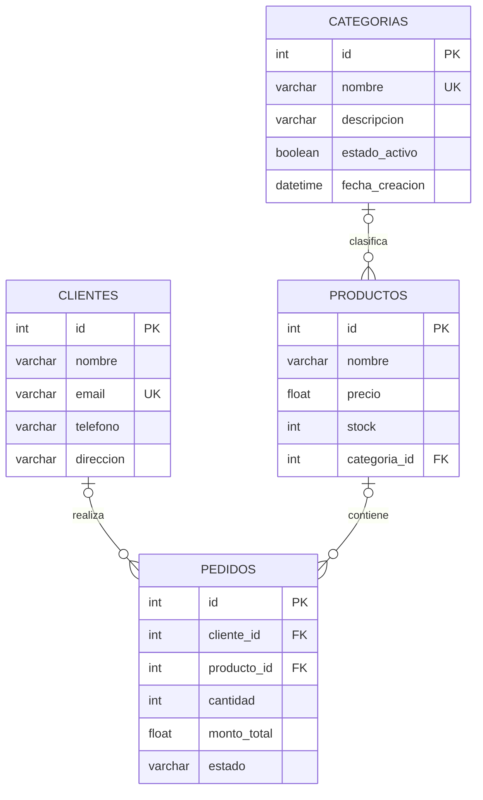

# Diagrama de datos - Cafetería Universitaria

## Modelo entidad-relación

## Claves y relaciones

- PK: clave primaria.
- FK: clave foránea.
- UK: clave única.

## Integridad de los datos

- Las categorías se relacionan con los productos.
- Los clientes se relacionan con los pedidos.
- Los productos se relacionan con los pedidos.
- El nombre de la categoría y el correo del cliente son únicos.
- Las migraciones se administran mediante Alembic.
- Los repositorios permiten controlar las transacciones.
- Las pruebas realizadas verificaron el rollback y la
  conservación de registros durante la última migración.

## Alcance

Este diagrama representa las cuatro tablas de negocio.
Las tablas de autenticación quedan fuera de este diagrama.